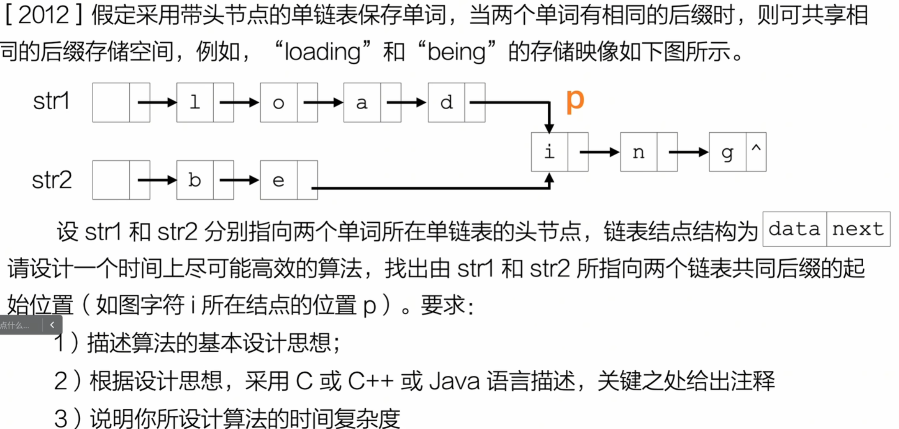

用双指针找到倒数第k个节点
int findNodeFS(Node* L,int k)
{
    Node *fast=L->next;
    Node *slow=L->next;
    for(int i=0;i<k;i++)
    {
        fast=fast->next;
    }
    while(fast!=nullptr)
    {
        fast=fast->next;
        slow=slow->next
    }
    cout<<"倒数第k个数是"<<slow->data<<endl;
}

Node* CommonNode(Node* headA,Node* headB)
{
    if(headA==nullptr||headB==nullptr)
        return nullptr;
    
    int lenA=0;
    int lenB=0;
    Node* p=headA;
    while(p!=nullptr)
    {
        p=p->next;
        lenA++;
    }
    p=headB;
    while(p!=nullptr)
    {
        p=p->next;
        lenB++;
    }

    Node* m;//快指针
    Node* n;//慢指针
    int step;
    if(lenA>lenB)
    {
        step=lenA-lenB;
        m=headA;
        n=headB;
    }
     else
    {
       step=lenB-lenA;
        m=headB;
        n=headA; 
    }
    for(int i=0;i<step;i++)
    {
        m->next;
    }
    while(m!=n)
    {
        m=m->next;
        n=n->next;
    }
    return m;
}
//反转链表
Node* reverseNode(Node *L)
{
    Node first=nullptr;
    Node second=L->next;
    Node third;
    while(second!=nullptr)
    {
        third=second->next;
        second->next=first;
        first=second;
        second=third; 
    }
    Node* head=new node;
    head->next==first;
    return head;
}